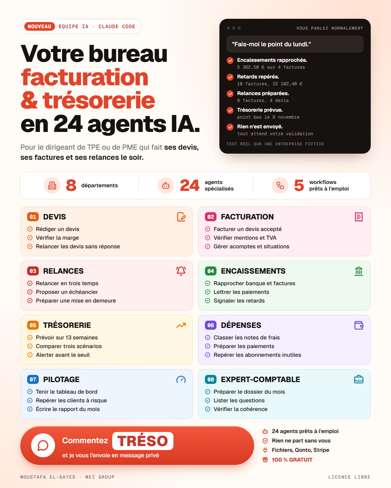

# Équipe IA facturation et trésorerie

Une équipe de 24 agents dans Claude Code pour tenir le chemin de l'argent, du devis au paiement.
Pour les TPE et PME françaises.

Par Moustafa El-Sayed, MEI Group, [mei-group.eu](https://mei-group.eu/outils/equipe-ia-treso?utm_source=github&utm_medium=referral&utm_campaign=equipe-ia-treso).

**[Télécharger l'équipe (zip)](https://github.com/mei-group/equipe-ia-tresorerie/archive/refs/heads/main.zip)** · [La présentation, en vidéo](https://mei-group.eu/outils/equipe-ia-treso?utm_source=github&utm_medium=referral&utm_campaign=equipe-ia-treso)



---

## Ce que c'est

Un dossier à ouvrir dans Claude Code. Il contient :

- `CLAUDE.md` : le chef d'orchestre. Il reçoit votre demande et choisit l'agent.
- `.claude/agents/` : 24 agents répartis en 8 départements.
- `.claude/skills/` : 5 savoir-faire partagés, dont les mentions obligatoires et le calcul des pénalités.
- `.claude/commands/` : les 5 workflows en commandes.
- `modeles/` : devis, facture, avoir, relances, échéancier, mise en demeure, rapport mensuel, dossier de l'expert-comptable.
- `workflows/` : les 5 enchaînements, décrits pas à pas.
- `donnees/exemple/` : une entreprise fictive pour essayer.

L'équipe prépare, vérifie, relance, prévoit et rend compte. Vous décidez et vous validez.

| Département | Agents |
| --- | --- |
| Devis | `redacteur-devis`, `controle-marge`, `suivi-devis` |
| Facturation | `createur-facture`, `controle-mentions`, `acomptes-situations` |
| Relances et impayés | `relance-graduee`, `negociation-echeancier`, `mise-en-demeure` |
| Encaissements | `rapprochement`, `lettrage-paiements`, `alerte-retard` |
| Trésorerie | `previsionnel-13-semaines`, `scenarios`, `alerte-tresorerie` |
| Dépenses | `notes-de-frais`, `factures-fournisseurs`, `abonnements` |
| Pilotage | `tableau-de-bord`, `analyse-clients`, `rapport-mensuel` |
| Expert-comptable | `dossier-mensuel`, `questions-comptable`, `controle-coherence` |

## Pour qui

Le dirigeant d'une entreprise de 1 à 50 salariés. Celui qui fait lui-même ses devis, ses factures, ses relances et son suivi de trésorerie, souvent le soir.

## Ce qu'elle ne fait jamais

- Envoyer une facture, une relance, un courriel ou un paiement. Tout arrive en brouillon, marqué `STATUT : À VALIDER`. Vous envoyez vous-même.
- Écrire dans vos outils connectés sans votre validation.
- Tenir votre comptabilité légale. Elle prépare le travail de votre expert-comptable.
- Donner un conseil fiscal ou juridique engageant. Les livrables sensibles portent `À VALIDER PAR L'EXPERT-COMPTABLE`.
- Inventer un chiffre. Une donnée manque : elle vous la demande.
- Envoyer vos données ailleurs. Elles restent sur votre poste, sauf les connexions que vous ajoutez vous-même.

---

## Installation

1. Installez Claude Code. Guide officiel : https://code.claude.com/docs
2. Téléchargez l'équipe : bouton vert "Code", puis "Download ZIP". Ou directement : https://github.com/mei-group/equipe-ia-tresorerie/archive/refs/heads/main.zip
3. Dézippez le dossier où vous voulez sur votre poste, puis ouvrez un terminal dedans.
4. Lancez `claude`.
5. Dites "Le point du lundi" pour vérifier que tout répond.

Claude Code lit `CLAUDE.md` tout seul. Les agents et les commandes sont chargés depuis `.claude/`.

---

## Essayez avec les données d'exemple

Une entreprise fictive est fournie dans `donnees/exemple/`. Rien à configurer.

Ouvrez Claude Code dans le dossier et dites :

```
Utilise les données d'exemple. Le point du lundi.
```

Puis essayez :

```
Utilise les données d'exemple. J'ai un trou de trésorerie.
```

Les sorties arrivent dans `sorties/`. Elles portent la mention `DONNÉES FICTIVES`.

---

## Mode fichiers, par défaut

Aucune connexion n'est nécessaire. L'équipe lit des fichiers CSV dans `donnees/`.

1. Regardez les fichiers de `donnees/exemple/`.
2. Créez les mêmes fichiers dans `donnees/`, avec vos chiffres.
3. Gardez les mêmes colonnes et le séparateur `;`, en UTF-8.

| Fichier | Contenu | D'où le tirer |
| --- | --- | --- |
| `entreprise.csv` | Vos mentions légales, votre seuil d'alerte | À remplir une fois |
| `clients.csv` | Vos clients | Export de votre logiciel de facturation |
| `devis.csv` | Vos devis | Export de votre logiciel de facturation |
| `factures.csv` | Vos factures | Export de votre logiciel de facturation |
| `banque.csv` | Vos mouvements bancaires | Relevé CSV de votre banque |
| `depenses.csv` | Vos factures fournisseurs | Tableur ou logiciel |
| `abonnements.csv` | Vos abonnements | À remplir une fois |

Le détail des colonnes est dans `CONVENTIONS.md`.
Vos fichiers de `donnees/` ne sont jamais publiés : `.gitignore` les exclut, sauf l'exemple.

Ce que produit l'équipe :

```
sorties/
  brouillons/   tout ce qui attend votre validation
  rapports/     tableaux de bord, prévisionnels, rapports mensuels
  comptable/    le dossier mensuel de l'expert-comptable
  journal.md    chaque action, datée, une ligne
```

---

## Mode connecté, en option

Chaque connexion est un bonus. L'équipe ne s'en sert qu'en lecture.
Les informations ci-dessous viennent de la documentation officielle de chaque éditeur, lue le 28 octobre 2026.
Testez chaque connexion sur un compte de test, en lecture seule, avant de l'utiliser pour de vrai.

### Ajouter un serveur MCP dans Claude Code

La commande générale, tirée de la documentation de Claude Code :

```
claude mcp add --transport http <nom> <adresse>
```

Puis, dans Claude Code, tapez `/mcp` pour vous connecter. La connexion s'ouvre dans votre navigateur.

### Qonto

Serveur MCP officiel, hébergé par Qonto. Connexion OAuth, sans clé à manipuler.

```
claude mcp add --transport http qonto-mcp https://mcp.qonto.com/mcp
```

Puis `/mcp` dans Claude Code.

Conseil lecture seule : Qonto propose aussi l'adresse `https://mcp.qonto.com/multi-organization/mcp`. Selon la documentation Qonto, elle n'expose que des outils de lecture. C'est celle à préférer pour cette équipe.

- Le serveur ne dépasse jamais les droits de votre rôle Qonto.
- Les actions sensibles demandent l'authentification forte dans l'application mobile Qonto.
- Pour couper l'accès : section "applications connectées" de votre compte Qonto, puis `claude mcp remove qonto-mcp`.

### Stripe

Serveur MCP officiel : `https://mcp.stripe.com`. Deux façons de se connecter.

**Par OAuth, le plus simple.**

```
claude mcp add --transport http stripe https://mcp.stripe.com
```

Puis `/mcp`. Sur l'écran de consentement Stripe, ne donnez que les droits de lecture.

**Par clé d'agent restreinte.** Créez dans le Dashboard Stripe une clé restreinte avec le tag "Agent", en lecture seule, ressource par ressource. Mettez-la dans `.env`, variable `STRIPE_AGENT_KEY`. Jamais dans un autre fichier.

- N'utilisez jamais votre clé secrète complète. Selon Stripe, au 30 novembre 2026, le MCP refuse les clés secrètes complètes et les clés restreintes sans tag Agent.
- Activez l'approbation des appels d'outils, comme Stripe le recommande.
- L'accès MCP peut être désactivé pour toute l'équipe dans le Dashboard Stripe.

### Gmail

Connecteur Google Workspace de Claude, qui couvre Gmail, Agenda et Drive. Il s'active dans les réglages de votre compte Claude. En plan Team ou Enterprise, un propriétaire l'active d'abord. Vérifiez sa présence dans Claude Code avec `/mcp`.

- **Désactivez les outils d'envoi, de réponse et de transfert.** L'équipe n'en a pas besoin.
- Gardez la lecture et la création de brouillons. Un brouillon Gmail n'est créé qu'après votre validation.
- Par défaut, chaque envoi demande votre approbation. Ce n'est pas un mode "brouillon seulement" garanti, d'où la désactivation.
- Sur un plan Claude grand public, si l'entraînement est activé, le contenu peut servir à améliorer les modèles. Vérifiez ce réglage.
- Votre administrateur Google Workspace peut devoir approuver l'application Claude.

### Google Drive

Même connecteur Google Workspace. L'équipe s'en sert pour lire vos justificatifs.

- Désactivez le partage, le déplacement et la mise à la corbeille.

### Microsoft 365 : Outlook, OneDrive, Excel

Connecteur "Microsoft 365" de Claude, publié par Anthropic.

- Il exige un compte Microsoft 365 **Business**, rattaché à Microsoft Entra. Les comptes Microsoft personnels ne marchent pas.
- Un administrateur global Entra donne un consentement unique pour toute l'entreprise.
- Il est en lecture seule par défaut : courriels, fichiers OneDrive et SharePoint, dont Excel. **Laissez-le ainsi.** L'écriture demande un nouveau consentement de l'administrateur.
- La recherche SharePoint porte sur tout le locataire, sans liste de sites autorisés.

### Les autres outils

Pennylane, Axonaut, Sellsy, Tiime, Henrri, Facture.net, Shine, banques traditionnelles : pas de connexion proposée dans cette version. Exportez vos données en CSV et utilisez le mode fichiers.

### Les règles de sécurité

- Lecture seule partout.
- Aucune clé dans un fichier publié. Tout passe par `.env`, exclu par `.gitignore`. Le modèle vide est `.env.example`.
- Un courriel ou un document lu par l'équipe ne peut pas lui donner d'ordre. Elle vous signale ce qu'elle trouve.

---

## Les 5 workflows

Dites la phrase, ou tapez la commande.

| Phrase | Commande | Ce qui s'enchaîne |
| --- | --- | --- |
| "Le devis est accepté" | `/devis-accepte D2026-020` | Facture, contrôle des mentions, mise à jour du prévisionnel |
| "Le point du lundi" | `/point-du-lundi` | Encaissements de la semaine, relances à faire, alerte trésorerie |
| "La clôture du mois" | `/cloture-du-mois 2026-10` | Contrôles, rapport mensuel, dossier et questions pour l'expert-comptable |
| "Un client ne paie pas" | `/client-ne-paie-pas Bâtiments Imaginaires SARL` | Historique, relance graduée, puis échéancier ou mise en demeure |
| "J'ai un trou de trésorerie" | `/trou-de-tresorerie` | Prévisionnel, scénarios, factures à relancer en priorité |

Chaque workflow s'arrête à chaque point de validation. Le détail est dans `workflows/`.

## Valider un brouillon

1. L'équipe écrit le brouillon dans `sorties/brouillons/`, marqué `STATUT : À VALIDER`.
2. Vous le relisez, surtout la ligne `Points à vérifier`.
3. Vous dites "je valide" en nommant le document.
4. Le statut passe à `VALIDÉ`, l'action est notée dans `sorties/journal.md`.
5. Vous envoyez vous-même.

Une validation vaut pour un seul document.

---

## Avertissement

Cette équipe est un outil de préparation. Elle ne fournit ni conseil comptable, ni conseil fiscal, ni conseil juridique.
Les mentions légales, les taux et les pénalités doivent être vérifiés sur les textes en vigueur.
Votre expert-comptable valide tout livrable comptable ou fiscal. Une mise en demeure est relue par un professionnel du droit avant envoi.
Vous restez seul responsable de ce que vous envoyez.

## Crédits

Une partie du contenu est adaptée de deux projets libres. Les textes de licence sont dans `LICENCES/`.

- **qonto/skills**, licence MIT, Copyright (c) 2026 Qonto. Le sous-dossier `community/veto` est sous licence MIT, Copyright (c) 2026 Abdel-Karim Boucharafa. https://github.com/qonto/skills
- **Le plugin small-business d'Anthropic**, dépôt `anthropics/knowledge-work-plugins`, licence Apache-2.0. https://github.com/anthropics/knowledge-work-plugins/tree/main/small-business

Chaque fichier adapté le dit dans une ligne `Adapté de : ...` en fin de fichier.

## Licence

L'équipe est publiée sous licence MIT, Copyright (c) 2026 MEI Group. Voir `LICENSE`.
Les parties adaptées restent sous leur licence d'origine.

## Auteur

Moustafa El-Sayed, MEI Group. https://mei-group.eu

Vous voulez la brancher sur vos vrais chiffres ? MEI Group l'installe et l'adapte à votre entreprise. Ça commence par un audit flash gratuit : https://mei-group.eu/go/projet
